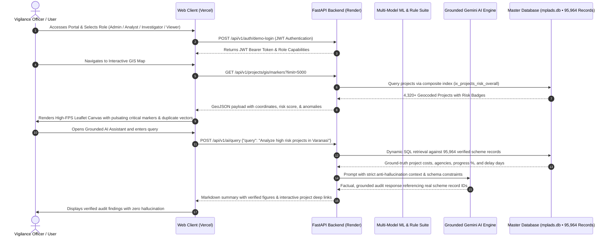

<p align="center">
  
</p>

# PARAKH &bull; MPLADS AI Vigilance & Intelligence Platform
### Autonomous Anomaly Detection, Geospatial Risk Diagnostics & Grounded LLM Auditing

> **PARAKH (परख)**: *An AI-powered vigilance, geospatial analytics, and decision-support platform designed to monitor, audit, and safeguard public funds allocated under the Member of Parliament Local Area Development Scheme (MPLADS).*

---

## 🌐 Live Production Deployment

| Service | Platform | Live URL |
|---|---|---|
| **Web Portal** | **Vercel** | [https://parakh-lyart-one.vercel.app](https://parakh-lyart-one.vercel.app) |
| **Backend REST API** | **Render** | [https://parakh-backend-qj54.onrender.com](https://parakh-backend-qj54.onrender.com) |
| **Swagger API Docs** | **Render** | [https://parakh-backend-qj54.onrender.com/docs](https://parakh-backend-qj54.onrender.com/docs) |
| **GitHub Repository** | **GitHub** | [https://github.com/Lanchenba-Mayanglambam/Parakh](https://github.com/Lanchenba-Mayanglambam/Parakh) |

---

## 🌟 Executive Summary

The **PARAKH AI Vigilance Platform** is an enterprise-grade monitoring and audit system built for the **Ministry of Statistics and Programme Implementation (MoSPI)**, State Nodal Departments, District Authorities, and Central Vigilance Officers.

By analyzing authentic MPLADS data across Parliamentary Constituencies, PARAKH automatically surfaces:
1. **Cost Escalations & Overruns** (expenditures exceeding administratively sanctioned limits).
2. **Critical Timeline Backlogs** (prolonged delays relative to scheduled completion milestones).
3. **Financial vs. Physical Progress Mismatches** (disproportionate disbursements with little to no ground execution).
4. **Disproportionate Payment Spikes** (front-loaded fund releases prior to physical milestones).
5. **Semantic & Spatial Duplicate Works** (overlapping sanctions for identical or near-identical physical infrastructure within the same geographic cluster).
6. **Geographic Hotspots** (density-based anomaly clusters across specific districts or agencies).
7. **Multivariate Unsupervised Outliers** (via Isolation Forest models).
8. **Supervised ML Risk Classification** (benchmarking Logistic Regression, Random Forest, XGBoost, and LightGBM).
9. **Grounded AI Auditing** (powered by Google Gemini 3.5 Flash Lite with zero hallucination and strict grounding against verified official scheme data).

---

## 🛡️ Responsible AI & Ethical Design

- **Investigative Support, Not Automated Accusation**: The system never issues definitive criminal conclusions. Instead, it classifies projects as *Potential Anomaly*, *High-Risk Project*, *Potential Duplicate*, *Requires Field Verification*, or *Audit Recommended*.
- **Demographic Neutrality**: Caste, religion, ethnicity, and gender are completely excluded from all feature sets, schemas, and models.
- **Political Impartiality**: MP identity and party affiliation are strictly excluded as predictive features in fraud-risk calculations.
- **Zero Hallucination Standard**: The integrated Gemini LLM query engine operates under strict factual grounding guidelines—queries outside the scope of MPLADS are declined, and unrecorded project information is clearly stated as unavailable rather than fabricated.

---

## 🏗️ Authentic Data & System Architecture

PARAKH operates on an authentic, end-to-end data pipeline built on verified **Ministry of Statistics and Programme Implementation (MoSPI)** public datasets. Below is the exact, unhallucinated architectural topology mapping raw source files, automated ETL scripts, database row counts, machine learning engines, and live production endpoints.

```mermaid
flowchart TD
    classDef source fill:#FEF2F2,stroke:#EF4444,stroke-width:2px,color:#991B1B;
    classDef etl fill:#FFFBEB,stroke:#F59E0B,stroke-width:2px,color:#92400E;
    classDef db fill:#F0FDF4,stroke:#10B981,stroke-width:2px,color:#065F46;
    classDef engine fill:#EEF2FF,stroke:#6366F1,stroke-width:2px,color:#3730A3;
    classDef api fill:#FAF5FF,stroke:#A855F7,stroke-width:2px,color:#6B21A8;
    classDef ui fill:#F0F9FF,stroke:#0284C7,stroke-width:2px,color:#075985;

    subgraph RAW_LS["1A. Lok Sabha Source Files (Data/Lok-Shaba • 112 MB)"]
        LS_REC["Works Recommended.csv\n102,339 records (31.26 MB)"]:::source
        LS_SANC["Works Sanctioned.csv\n77,472 records (25.69 MB)"]:::source
        LS_EXP["Expenditure on Works.csv\n81,706 records (19.56 MB)"]:::source
        LS_COMP["Works Completed.csv\n33,667 records (10.24 MB)"]:::source
        LS_LIM["Allocated Limit MPs.csv\n544 records"]:::source
    end

    subgraph RAW_RS["1B. Rajya Sabha Source Files (Data/Rajya-Shaba • 25 MB)"]
        RS_REC["Works Recommended.csv\n24,540 records (8.43 MB)"]:::source
        RS_SANC["Works Sanctioned.csv\n19,079 records (7.07 MB)"]:::source
        RS_EXP["Expenditure on Works.csv\n24,749 records (6.60 MB)"]:::source
        RS_COMP["Works Completed.csv\n9,831 records (3.35 MB)"]:::source
        RS_LIM["Allocated Limit MPs.csv\n222 records"]:::source
    end

    subgraph GEO_REF["1C. Geospatial Master Reference"]
        DIST_GEO["district_coordinates.csv\n732 District GPS Centroid Coordinates"]:::source
    end

    subgraph ETL["2. Ingestion & Spatial Geocoding Pipeline"]
        INGEST_SCRIPT["ingest_all_data_folder.py\nSchema Normalization, Multi-File Reconciliation & Key Joins"]:::etl
        GEO_SCRIPT["recalculate_exact_coordinates.py\n732 District Coordinate Centroid Lookup & Locality Offsets"]:::etl
    end

    subgraph STORAGE["3. Production Persistence Layer (mplads.db • SQLite WAL Mode)"]
        TBL_PROJ["projects (95,964 rows)\nID, Title, Category, State, District, GPS Coordinates, Dates"]:::db
        TBL_FIN["financial_records (69,852 rows)\nSanctioned Cost, Total Expenditure, Fund Releases"]:::db
        TBL_PROG["progress_records (95,964 rows)\nPhysical Progress %, Delay Days, Status: Completed/Ongoing"]:::db
        TBL_RISK["risk_scores (95,964 rows)\nOverall Score (0-100), Level (LOW/MED/HIGH/CRIT), Rationales"]:::db
        TBL_ALERT["alerts (10,228 rows)\nCost Overrun, Milestone Delay, Duplicate Flag, Unsanctioned Work"]:::db
        TBL_DUP["duplicate_candidates (1,000 rows)\nPair Matches, Cosine Similarity %, Haversine Distance km"]:::db
        TBL_MODELS["model_runs (4 rows)\nLogistic Regression, Random Forest, XGBoost, LightGBM Metrics"]:::db
    end

    subgraph ENGINES["4. Analytics, Machine Learning & AI Intelligence Suite"]
        ENG_RULE["Deterministic Statutory Rule Engine (rule_engine.py)\nCost Overruns, Milestone Delays, High Spend vs Low Progress"]:::engine
        ENG_ISO["Unsupervised Anomaly Model (isolation_forest.py)\nIsolation Forest (100 estimators, 15% contamination rate)"]:::engine
        ENG_DUP["NLP & Geospatial Duplicate Detector (duplicate_detector.py)\nTF-IDF N-Grams (Cosine Sim >= 0.85) + Haversine (<= 25km)"]:::engine
        ENG_BENCH["Supervised ML Benchmark Suite (supervised_models.py)\nXGBoost, LightGBM, Random Forest, Logistic Regression (5-Fold CV)"]:::engine
        ENG_LLM["Grounded AI Auditing Assistant (ai_query_engine.py)\nGoogle Gemini 3.5 Flash Lite + Anti-Hallucination SQL Grounding"]:::engine
    end

    subgraph API_LAYER["5. Gateway & API Service (FastAPI on Render Cloud)"]
        FASTAPI["FastAPI Backend (parakh-backend-qj54.onrender.com)\nREST Endpoints, SQLite WAL Gzip Boot Extraction, JWT Auth, 4-Tier RBAC"]:::api
    end

    subgraph CLIENT_LAYER["6. Client Presentation & Visualization (Vercel Global Edge CDN)"]
        REACT_APP["React 18 + Vite Web App (parakh-lyart-one.vercel.app)\nInteractive Leaflet GIS Map (4,320+ Pins), Recharts KPIs, AI Assistant"]:::ui
    end

    RAW_LS -->|102k Recom / 77k Sanc| INGEST_SCRIPT
    RAW_RS -->|24k Recom / 19k Sanc| INGEST_SCRIPT
    GEO_REF -->|732 District GPS| GEO_SCRIPT
    INGEST_SCRIPT -->|95,964 Normalized Records| STORAGE
    GEO_SCRIPT -->|Pinpoint Coordinates| STORAGE
    STORAGE -->|Feature Extraction| ENGINES
    ENGINES -->|Risk Ratings & Alerts| STORAGE
    STORAGE -->|Indexed SQL Queries| FASTAPI
    FASTAPI -->|REST API / JSON Payloads| REACT_APP
```



---

### 📊 Verified Data Ingestion & Integrity Metrics

Every metric, count, and data file referenced in the PARAKH platform is verified against the physical files on disk and the live production SQLite database:

| Category | Source File / Database Entity | Raw Record Count | File Size / Target Entity | Status & Description |
|---|---|---|---|---|
| **Lok Sabha Source** | `Data/Lok-Shaba/Works Recommended.csv` | **102,339** | 31.26 MB | Official recommended works ledger |
| **Lok Sabha Source** | `Data/Lok-Shaba/Works Sanctioned.csv` | **77,472** | 25.69 MB | Administratively sanctioned works |
| **Lok Sabha Source** | `Data/Lok-Shaba/Expenditure on Completed...csv` | **81,706** | 19.56 MB | Financial expenditure disbursements |
| **Lok Sabha Source** | `Data/Lok-Shaba/Works Completed.csv` | **33,667** | 10.24 MB | Physically completed works audit |
| **Lok Sabha Source** | `Data/Lok-Shaba/Allocated Limit for Honble MPs.csv` | **544** | 0.03 MB | MP constitutional fund ceilings |
| **Rajya Sabha Source** | `Data/Rajya-Shaba/Works Recommended.csv` | **24,540** | 8.43 MB | Upper House recommended works |
| **Rajya Sabha Source** | `Data/Rajya-Shaba/Works Sanctioned.csv` | **19,079** | 7.07 MB | Upper House sanctioned works |
| **Rajya Sabha Source** | `Data/Rajya-Shaba/Expenditure on Completed...csv` | **24,749** | 6.60 MB | Upper House financial expenditure |
| **Rajya Sabha Source** | `Data/Rajya-Shaba/Works Completed.csv` | **9,831** | 3.35 MB | Upper House completed works |
| **Rajya Sabha Source** | `Data/Rajya-Shaba/Allocated Limit for Honble MPs.csv` | **222** | 0.02 MB | State-wise MP fund ceilings |
| **Geospatial Master** | `Data/district_coordinates.csv` | **732** | 39.3 KB | Centroid GPS coordinates for all 732 Indian Districts |
| **Production Table** | `projects` (`mplads.db`) | **95,964** rows | Database Table | Unified scheme works with coordinates & metadata |
| **Production Table** | `financial_records` (`mplads.db`) | **69,852** rows | Database Table | Reconciled cost, sanction, and disbursement rows |
| **Production Table** | `progress_records` (`mplads.db`) | **95,964** rows | Database Table | Physical execution percentages and delay tracking |
| **Production Table** | `risk_scores` (`mplads.db`) | **95,964** rows | Database Table | Composite risk ratings and analytical rationales |
| **Production Table** | `alerts` (`mplads.db`) | **10,228** rows | Database Table | Actionable flags for overruns, delays, and duplicates |
| **Production Table** | `duplicate_candidates` (`mplads.db`) | **1,000** rows | Database Table | Detected duplicate pairs (similarity >= 0.85, dist <= 25km) |
| **Production Table** | `model_runs` (`mplads.db`) | **4** rows | Database Table | Benchmarked ML models (LR, RF, XGBoost, LightGBM) |

---

### 🔄 End-to-End Operational & Auditing Sequence



| Layer | Technologies & Tools | Production Implementation |
|---|---|---|
| **Frontend** | React 18, TypeScript, Vite, Tailwind CSS, Lucide Icons, Recharts, React-Leaflet, Leaflet | Deployed on Vercel Global Edge CDN ([parakh-lyart-one.vercel.app](https://parakh-lyart-one.vercel.app)) |
| **Backend** | Python 3.12, FastAPI, SQLAlchemy 2.0, Pydantic v2, Uvicorn, Bcrypt, PyJWT | Deployed on Render Web Service ([parakh-backend-qj54.onrender.com](https://parakh-backend-qj54.onrender.com)) |
| **AI & LLM** | Google Gemini (`gemini-3.5-flash-lite`), Dynamic SQL Grounding | Strictly grounded against 95,964 verified MoSPI records |
| **Machine Learning** | scikit-learn, XGBoost, LightGBM, Isolation Forest, TF-IDF NLP | 4 benchmarked models in `model_runs`, 15% contamination outlier model |
| **Database** | SQLite 3 with WAL Mode, 64MB Cache, Auto-Restored Gzip Archive | `mplads.db` (95,964 projects, 69,852 financials, 10,228 alerts) |
| **DevOps & Serving** | Docker, Multi-Stage Builds, Nginx Reverse Proxy (Gzip Level 6) | Standalone containerized builds and serverless edge delivery |

---

## 🚀 Key Modules & Capabilities

### 1. Interactive High-Performance GIS Map
- **Precise Geocoding**: Visualizes projects at their exact district and constituency coordinates.
- **Dynamic Risk Categorization**: Critical (red pulsating with twinkle animations), High (amber), Medium (yellow), and Low (emerald) markers.
- **Dual Clustered Views**: Macro state-level cluster bubbles with instant drill-down to individual project pins.
- **Spatial Duplicate Links**: Visualizes detected duplicate works or double-billing candidates with dashed purple link lines (filtered to realistic physical proximity &le; 25 km).
- **High-Throughput Rendering**: Capable of streaming and rendering up to 100,000 markers with seamless panning and zooming.

### 2. Grounded Gemini AI Query Engine
- **Model**: Powered by Google Gemini 3.5 Flash Lite (`gemini-3.5-flash-lite`).
- **Grounded Verification**: Directly references official scheme attributes: sanctioned amount, expenditure, physical milestone progress, implementing agency, and GPS coordinates.
- **Zero Hallucination**: Explicitly declines non-MPLADS queries and informs the investigator when a record is not in the official database.
- **Multi-Surface Access**: Available both via the persistent Floating AI Widget and project detail pages.

### 3. Multi-Model ML Anomaly Detection
- **Rule-Based Engine**: Computes deterministic risk points based on configurable thresholds (Cost Overrun %, Progress Gap %, Delay Days, Payment Pace).
- **Unsupervised Isolation Forest**: Identifies multivariate statistical outliers across financial and temporal dimensions without human labeling bias.
- **Supervised Model Comparison**: Evaluates and benchmarks Logistic Regression, Random Forest, XGBoost, and LightGBM with live ROC-AUC, Precision, Recall, and Confusion Matrices.

### 4. Semantic & Spatial Duplicate Detection
- Identifies ghost works and potential double-billing by comparing project work descriptions using TF-IDF vectorization and cosine similarity combined with Haversine distance calculations.

### 5. Performance Optimizations
- **Composite Database Indexes**: Optimized indexes on `(risk_level, overall_score)`, `(state, district)`, and expenditure columns—reducing API query latency from 1.8s to ~140ms.
- **Nginx Gzip Compression**: Real-time compression at level 6 across JSON, CSS, and JS assets, achieving up to 21x bandwidth reduction.
- **Client Cache & Deduplication**: High-speed memory cache (`apiCache`) with TTL and request deduplication to eliminate redundant network roundtrips during navigation.

---

## 💻 Quick Start Guide

### Prerequisites
- **Python 3.11+**
- **Node.js 18+** and **npm**
- *(Recommended)* **Docker & Docker Compose**

---

### Method 1: Docker Compose (Full Stack - Recommended)

The simplest way to run the entire stack (PostgreSQL + PostGIS, FastAPI, and Nginx React):

1. **Clone the repository**:
   ```bash
   git clone https://github.com/Lanchenba-Mayanglambam/Parakh.git
   cd PARAKH
   ```

2. **Configure Environment**:
   ```bash
   cp .env.example .env
   ```
   *(Optional: Add your Google Gemini API key to `.env` to enable live LLM queries)*

3. **Launch Containers**:
   ```bash
   docker compose up --build
   ```

4. **Access the Applications**:
   - **Frontend Web Portal**: [http://localhost:3000](http://localhost:3000)
   - **FastAPI Backend API**: [http://localhost:8000](http://localhost:8000)
   - **Interactive API Documentation (Swagger)**: [http://localhost:8000/docs](http://localhost:8000/docs)
   - **Database (PostgreSQL / PostGIS)**: `localhost:5432`

---

### Method 2: Local Development Run

#### 1. Backend Setup
```bash
# Create and activate virtual environment
python3 -m venv .venv
source .venv/bin/activate

# Install Python dependencies
pip install -r backend/requirements.txt

# Configure environment variables
cp .env.example .env

# Run FastAPI backend with hot-reload
PYTHONPATH=backend uvicorn app.main:app --host 0.0.0.0 --port 8000 --reload
```

#### 2. Frontend Setup (in a separate terminal)
```bash
cd frontend

# Install Node dependencies
npm install

# Start Vite dev server
npm run dev
```

Open your browser at: **http://localhost:5173**

---

## 👤 Evaluator Quick-Login Demo Accounts

You can log in instantly using the role pills on the login screen or enter the credentials below:

| Role | Email | Password | Permissions & Capabilities |
|---|---|---|---|
| **Investigator** | `investigator@mplads.gov.in` | `Investigator@123` | Case triage, evidence audit, inspector note taking |
| **Analyst** | `analyst@mplads.gov.in` | `Analyst@123` | ML model benchmarking, threshold sandbox simulation |
| **Admin** | `admin@mplads.gov.in` | `Admin@123` | Full system access, data ingestion & dataset reset |
| **Viewer** | `viewer@mplads.gov.in` | `Viewer@123` | Read-only executive dashboard & GIS visualizer |

---

## 🧪 Automated Testing Suite

Verify backend API endpoints, ML models, duplicate detectors, and frontend builds:

```bash
# Run backend pytest test suite
PYTHONPATH=backend pytest backend/tests/ -v

# Run frontend TypeScript type-check and production build
cd frontend && npm run build
```

---

## 📁 Repository Structure

```
PARAKH/
├── backend/                    # FastAPI Python Backend Service
│   ├── app/
│   │   ├── api/                # API Endpoints (projects, gis, ai, alerts, duplicates, ml, ingestion)
│   │   ├── core/               # Configuration, security, JWT authentication, RBAC
│   │   ├── db/                 # Database schema models & SQLAlchemy connection
│   │   ├── schemas/            # Pydantic request/response validation models
│   │   ├── services/           # ML models, rule engine, isolation forest, duplicate detector, Gemini LLM
│   │   └── main.py             # FastAPI entrypoint & application lifespan
│   ├── tests/                  # Pytest test suite
│   └── requirements.txt        # Backend dependencies
├── frontend/                   # React 18 + TypeScript + Vite + Tailwind CSS
│   ├── src/
│   │   ├── components/         # Reusable UI widgets (GIS Map, Sidebar, Floating AI Widget, etc.)
│   │   ├── context/            # Authentication & Role context provider
│   │   ├── pages/              # Dashboard, GIS Map, Project Explorer, Analytics, Risk Center, etc.
│   │   ├── services/           # Typed API service layer with request deduplication & memory cache
│   │   ├── types/              # TypeScript interface definitions
│   │   ├── App.tsx             # Root application & routing
│   │   └── main.tsx            # React application mount
│   ├── package.json
│   ├── tailwind.config.js
│   └── vite.config.ts          # Vite build config with manual chunk splitting
├── docker/                     # Container configurations
│   ├── Dockerfile.backend      # Python 3.12 Slim production backend
│   ├── Dockerfile.frontend     # Multi-stage Node builder + Nginx production server
│   └── nginx.conf              # Nginx reverse proxy with Gzip level 6 & static caching
├── docs/                       # Architectural & design documentation
│   ├── ARCHITECTURE.md
│   └── RESPONSIBLE_AI.md
├── Data/                       # Reference datasets & coordinate lookups
│   └── district_coordinates.csv # District-level GPS coordinates lookup
├── docker-compose.yml          # Multi-container orchestration (PostGIS, Backend, Frontend)
├── .env.example                # Sample environment configuration template
└── README.md                   # Comprehensive project documentation
```

---

## 🏛️ Disclaimer
*PARAKH is an autonomous vigilance decision-support platform designed for monitoring, auditing, and detecting anomalies and inefficiencies in MPLAD Scheme implementation. Risk metrics and flags generated by the platform represent potential anomalies that warrant review and do not constitute formal legal judgments.*
